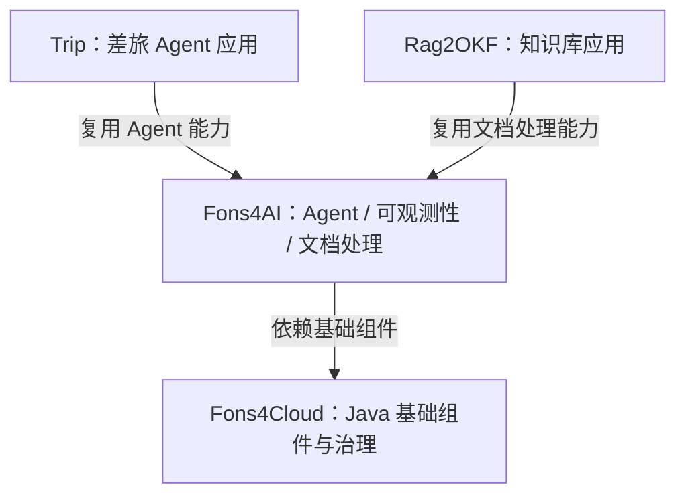

# Hi, I'm nauyiq 👋

**Java 后端开发者，专注 Agent 与 AI 应用工程实践。**

关注如何将模型、工具和业务流程组合成可落地的应用。目前围绕差旅 Agent、知识库与 Java 基础框架持续实践，重点探索执行管理、人工确认、可观测性和文档处理。

**[业务应用](#业务应用) · [项目架构](#项目架构) · [技术设计](#技术设计)**

<!-- 业务 Demo 聚合页上线后，在这里增加“体验业务 Demo”的链接。 -->

## 业务应用

### Trip · 智能差旅助手

围绕差旅信息查询、行程规划与行程管理，探索业务 Agent 的协作与执行控制。

- **业务协作**：由 Master Agent 按任务需要委派信息查询、行程规划与管理子 Agent。
- **人工确认**：对配置要求确认的工具调用暂停执行，接收决定后恢复对应执行分段。
- **执行管理**：处理流式响应、会话运行占用、取消与结果收口。
- **过程追踪**：关联业务步骤、Agent、模型与工具调用，帮助解释执行过程。

[项目源码](https://github.com/nauyiq/fons4ai-trip) · [运行机制](https://github.com/nauyiq/fons4ai/blob/master/docs/agent-runtime.md) · [可观测性设计](https://github.com/nauyiq/fons4ai/blob/master/docs/observability.md)

### Rag2OKF · 知识库与文档处理应用

围绕知识库、文档解析与分块管理，探索文档处理能力与业务应用的衔接。

- **文档管理**：组织知识库与文档的业务入口。
- **解析适配**：通过统一文档模型衔接不同解析方式。
- **来源保留**：在解析与分块过程中保留文档来源关系。
- **分块管理**：围绕策略、结果结构与文档绑定进行处理和校验。

[项目源码](https://github.com/nauyiq/fons4ai-rag2okf) · [文档处理设计](https://github.com/nauyiq/fons4ai/blob/master/docs/document-processing.md)

## 项目架构

业务应用承接具体场景，Fons4AI 沉淀 AI 工程能力，Fons4Cloud 提供 Java 基础组件。

| 项目 | 定位 | 架构入口 |
| --- | --- | --- |
| [Fons4AI](https://github.com/nauyiq/fons4ai) | Java AI 应用基础框架，组织 Agent 运行、人工确认、执行观测与文档处理能力 | [系统架构](https://github.com/nauyiq/fons4ai/blob/master/docs/architecture.md) |
| [Fons4Cloud](https://github.com/nauyiq/fons4cloud) | Java 微服务基础框架，提供认证、网关、消息、公共组件与治理控制台 | [系统架构](https://github.com/nauyiq/fons4cloud/blob/master/docs/architecture.md) |

## 技术方向

- **Java 后端**：Spring Boot、Spring Cloud、认证鉴权、消息与基础组件。
- **AI 应用**：AgentScope、Spring AI、LangChain4j，以及业务工具和文档处理集成。
- **工程实践**：响应式执行、状态管理、人工确认、OpenTelemetry 与执行追踪。

这些仓库是我的个人工程实践。各项目的实现范围、接入方式与验证边界，请以对应 README 和设计文档为准。
